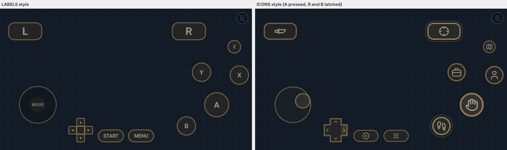
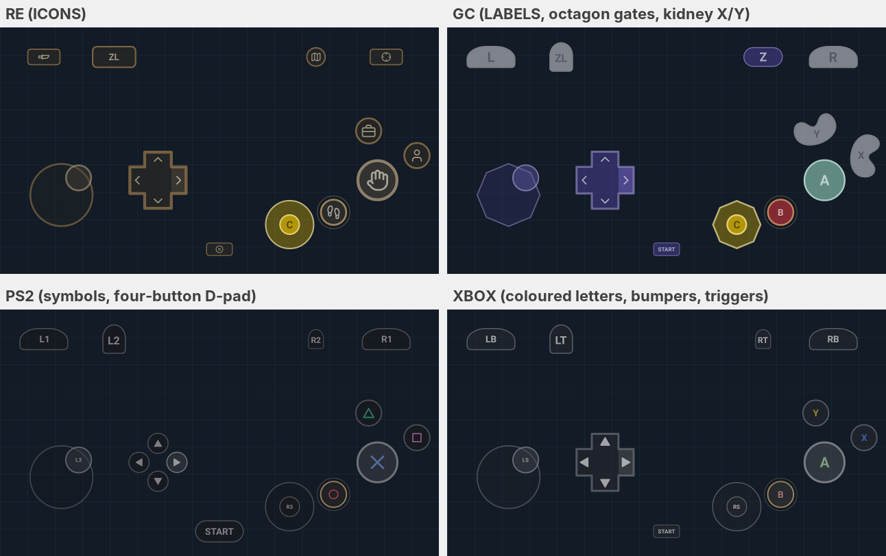
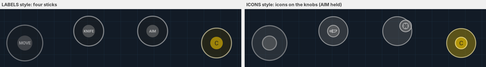

# RetroTouch

> A lightweight, configurable and reusable touch-control overlay for Android games.

[](https://developer.android.com/)
[](#project-status)
[](https://www.java.com/)

[](LICENSE)

[](https://paypal.me/andiweli)


RetroTouch is an engine-agnostic Android touch-controls library for games and source ports. It adds a resolution-independent virtual joystick, configurable action buttons, relative FPS look controls and optional menu navigation above an existing Android game view.

The overlay is delivered as a replaceable Android Archive (`.aar`) and is suitable for Java, JNI, SDL, OpenGL, `SurfaceView`, `GLSurfaceView` and native game engines. The game keeps ownership of its input system: RetroTouch emits stable action IDs and normalized movement/look callbacks, while a small game-specific bridge maps them to keys, axes or engine events.

RetroTouch was created for retro FPS ports that need modern Android multitouch controls without hard-coding a different overlay into every game.


## Key features

**Platform**
- Android 4.1 / API 16 through Android 16 / API 36
- no AndroidX requirement and no external runtime dependencies
- compatible AAR updates without copying RetroTouch source into each game
- MIT license for use in open-source and commercial projects

**Controls**
- true pointer-ID-based multitouch
- up to 16 configurable action buttons
- up to two analog sticks by default and up to eight with `setMaxSticks`, two relative-look zones and two digital D-pads
- a move stick plus optional extra analog sticks, for example a GameCube C-stick or aim and knife sticks, that report separately
- optional finger down/up callbacks per stick
- stick knobs that run with their center along the ring
- normalized layouts for 4:3, 16:9, 20:9, tablets and ultrawide Automotive displays

**Appearance**
- automatic one- or two-line button labels with dynamic font fitting
- large, centered one-character labels such as `A` or `B` that scale with the button
- rectangle buttons with slightly rounded corners for START, SELECT, MENU, shoulders and triggers
- optional game-defined colors per action, per control or for the whole overlay, including the border
- optional icon style with 14 built-in icons, a thicker border and a golden ring for latched buttons
- a style toggle in the editor so players can switch between labels and icons; the game picks the default
- rounded-rectangle and capsule buttons with an aspect ratio per control or per action
- separate colors for pressed and latched buttons
- optional skins such as RE, GC, PS2 or XBOX that the player cycles with the editor's style button
- kidney, bumper and trigger shapes, two-colour and filled icons, a four-button D-pad and octagonal stick gates

**Modes and layouts**
- independent `OFF`, `GAMEPLAY` and optional `NAVIGATION` modes
- persistent per-game gameplay and navigation layouts

**Layout editor**
- built-in editor for adding, moving, resizing, remapping and changing opacity
- every control can be dragged right up to each screen edge
- a selection frame that fits the visible control
- movable, scalable and opacity-adjustable Settings button
- vertically draggable editor toolbar
- optional safe insets that keep the editor toolbar clear of a camera cutout

**Gameplay support**
- FPS-friendly simultaneous movement, turning and held FIRE
- host-controlled latched-button display, suitable for always-run modes
- public input-reset API for respawn, level changes and engine input resets
- controller detection for built-in, USB, Bluetooth, Xbox, PlayStation and generic gamepads

## Typical use cases

RetroTouch is designed for:

- Android game ports and source ports
- retro FPS and action games
- emulator-style ports with console button layouts
- SDL and JNI-based games
- OpenGL and custom-rendered Android games
- Unreal Engine 1 ports, including Unreal and Unreal Tournament 99
- Android handhelds, phones, tablets, ChromeOS and Android Automotive
- projects that need an editable virtual joystick and gamepad-style touch overlay

## Project status



The current release is **RetroTouch 1.0.0-beta.13**.

| Version | Date | Highlights |
|---|---|---|
| beta.10 | 2026-11-10 | Optional icon style with 14 icons and a style toggle in the editor; capsule and rounded-rectangle shapes; aspect ratio per action; pressed and latched colors |
| beta.11 | 2026-11-14 | Safe insets keep the editor bar clear of a camera cutout (`setSafeInsets`) |
| beta.12 | 2026-11-16 | Up to 8 sticks per layout (`setMaxSticks`); icons and labels on stick knobs in the icon style; finger down/up per stick (`RetroTouchStickTouchListener`) |
| beta.13 | 2026-11-17 | Skins such as RE, GC, PS2 and XBOX that the player cycles in the editor; kidney, bumper and trigger shapes; two-colour and filled icons with PlayStation-style symbols; four-button D-pad; octagonal stick gates; labels on the move stick's knob; optical centering |
| beta.9 | 2026-11-03 | Controls reach every screen edge, thicker borders, stick knobs run along the ring |
| beta.8 | 2026-11-03 | Rectangle buttons for START, SELECT, MENU, shoulders and triggers; border colors; fitted editor frame |
| beta.7 | 2026-10-26 | Optional second analog stick that reports separately (`onStick`) |
| beta.6 | 2026-10-19 | Large, centered one-character labels |
| beta.5 | 2026-10-19 | Optional game-defined colors |
| beta.4 | 2026-08-28 | Movable settings button, draggable editor toolbar |
| beta.3 | 2026-08-28 | Input reset for respawn, level changes and focus loss |
| beta.2 | 2026-08-27 | Universal one- or two-line button labels |
| beta.1 | 2026-08-27 | First public beta with the complete core feature set |

The complete core feature set has been tested with the Android port of **Breathless**, including multitouch movement, relative look, held FIRE while turning, always-run indication, D-pad menu navigation, controller detection and editable layouts. The additions of beta.5 to beta.13 are covered by automated rendering tests against the released AAR. The beta phase continues while RetroTouch is tested across additional engines and input stacks.

## How RetroTouch is structured

RetroTouch intentionally separates reusable overlay code from game-specific input logic:

1. **`retrotouch.aar`** — reusable RetroTouch library
2. **game bridge** — maps RetroTouch callbacks to the game's input system
3. **game layout** — defines available actions, labels, default positions and, optionally, colors, button shapes and icons

With this structure, a compatible RetroTouch update normally requires only replacing `app/libs/retrotouch.aar` and rebuilding the APK or AAB. The game bridge and native engine code remain unchanged.

The AAR is compiled into the final application. It cannot be exchanged inside an already installed APK without rebuilding and reinstalling the game.

## Installation with the AAR

The current AAR is in this repository as [`source/RetroTouch-1.0.0-beta.13.aar`](source/RetroTouch-1.0.0-beta.13.aar). Copy it into the application module as:

```text
app/libs/retrotouch.aar
```

Add it to the app module's `build.gradle`:

```groovy
dependencies {
    implementation files('libs/retrotouch.aar')
}
```

Do not also copy RetroTouch Java sources into the app module. Keeping the library behind the AAR boundary makes future updates predictable.

The `source/` folder also contains the [release notes](source/RetroTouch-1.0.0-beta.13-Release-Notes.md), the complete source package (`RetroTouch-1.0.0-beta.13-source.zip`) and detailed integration guides in [English](source/RetroTouch-1.0.0-beta.13-Guide-EN.md) and [German](source/RetroTouch-1.0.0-beta.13-Anleitung-DE.md).

## Minimal integration

Place RetroTouch above the game's existing view:

```java
FrameLayout.LayoutParams matchParent = new FrameLayout.LayoutParams(
        FrameLayout.LayoutParams.MATCH_PARENT,
        FrameLayout.LayoutParams.MATCH_PARENT);

FrameLayout root = new FrameLayout(this);
root.addView(gameView, matchParent);

RetroTouchView retroTouch = new RetroTouchView(this);
root.addView(retroTouch, matchParent);

setContentView(root);
```

Register the actions supported by the game:

```java
retroTouch.registerAction("fire", "Fire");
retroTouch.registerAction("use", "Use");
retroTouch.registerAction("run", "Run");
retroTouch.registerAction("weapon_next", "Next Weapon");
retroTouch.registerAction("menu", "Menu");
```

Define a normalized default gameplay layout:

```java
List<RetroTouchControl> gameplay = new ArrayList<RetroTouchControl>();

gameplay.add(RetroTouchControl.lookZone(
        "look", 0.72f, 0.48f, 0.56f, 0.78f));

gameplay.add(RetroTouchControl.moveStick(
        "move", 0.16f, 0.76f, 0.25f));

gameplay.add(RetroTouchControl.button(
        "fire_button", "fire", "Fire", 0.89f, 0.71f, 0.15f));

retroTouch.setGameplayLayout(
        new RetroTouchLayout("my_game", gameplay));
```

Map callbacks to the input path already used by the game:

```java
retroTouch.setListener(new RetroTouchAdapter() {
    @Override
    public void onAction(String actionId, boolean pressed) {
        nativeTouchAction(actionId, pressed);
    }

    @Override
    public void onMove(float x, float y) {
        nativeTouchMove(x, y);
    }

    @Override
    public void onLook(float deltaX, float deltaY) {
        nativeTouchLook(deltaX, deltaY);
    }
});
```

RetroTouch deliberately does not decide what `fire`, `use` or `menu` means. The host game maps each action ID to its own keyboard, mouse, controller, SDL, JNI or native engine input.

## Overlay modes

RetroTouch provides three universal modes:

```java
retroTouch.setMode(RetroTouchMode.OFF);
retroTouch.setMode(RetroTouchMode.GAMEPLAY);
retroTouch.setMode(RetroTouchMode.NAVIGATION);
```

- **`OFF`** — draws nothing and lets the game's original touch input handle menus, intros or skip screens
- **`GAMEPLAY`** — shows movement, look and action controls
- **`NAVIGATION`** — optionally shows a digital D-pad plus freely mapped OK/Back-style buttons

A game is not required to use every mode. For example, a port with native touch menus can keep RetroTouch `OFF` outside gameplay.

## Labels and button shapes

Labels come from the game. RetroTouch wraps long labels to at most two balanced lines, shrinks the font until the label fits and honors an explicit `\n`. Labels with exactly one character, such as `A`, `B`, `X` or `Y`, are drawn twice as large, scale with the button and sit exactly in the center.

RetroTouch chooses a button's shape from its label, so existing games get it with a new AAR alone:

| Label | Shape |
|---|---|
| `START`, `SELECT`, `MENU` | compact rectangle |
| `L`, `R`, `ZL`, `ZR`, `L1`, `R1`, `L2`, `R2`, `LB`, `RB`, `LT`, `RT` | slightly larger rectangle |
| everything else | round |

Rectangles have slightly rounded corners and are touched on their whole area. A game can choose the shape per action, for example a rectangular GameCube `Z` button:

```java
retroTouch.setButtonShape("z", RetroTouchButtonShape.SHOULDER); // RECTANGLE, ROUND, AUTO
```

Two more shapes take an aspect ratio (width / height): `ROUNDED_RECT` with corners of 35 % of the height and `CAPSULE` with half-circle ends. For them the button's size is its height. Shapes apply in both button styles.

```java
// On a single control in the default layout:
gameplay.add(RetroTouchControl.button("btn_start", "start", "Start", 0.44f, 0.90f, 0.085f,
        null, RetroTouchButtonShape.CAPSULE, 2.1f));

// Per action, so that buttons added with ADD or remapped with ACTION match:
retroTouch.setButtonShape("l", RetroTouchButtonShape.ROUNDED_RECT);
retroTouch.setButtonAspect("l", 1.95f);
```

A control in the default layout with its own aspect ratio and the same action keeps it; every other button of the action uses `setButtonAspect`, else 1:1. Shapes and aspect ratios come from the game on every load and are not stored in saved layouts.

## Optional colors

By default all controls use RetroTouch's neutral grey. A game can supply its own colors, for example a green A and a red B button as on a GameCube controller. Like labels, colors come from the game: players cannot change them, and `ALPHA` still controls opacity only.

```java
// One fill color is enough: pressed color, border and readable text are derived.
RetroTouchColors green = RetroTouchColors.of(Color.rgb(31, 166, 74));
RetroTouchColors red = RetroTouchColors.of(Color.rgb(217, 43, 43));

// On the action: every button mapped to "a" or "b" uses these colors.
retroTouch.registerAction("a", "A", green);
retroTouch.registerAction("b", "B", red);

// Only a different border (ring) color.
retroTouch.registerAction("x", "X",
        RetroTouchColors.of(Color.rgb(208, 208, 208)).withBorderColor(Color.rgb(255, 215, 0)));

// On a single control: the optional last parameter of button(), moveStick() or dPad().
gameplay.add(RetroTouchControl.moveStick(
        "move", 0.16f, 0.76f, 0.25f, RetroTouchColors.of(Color.rgb(90, 90, 90))));

// For everything else: one base color for all buttons, sticks and D-pads.
retroTouch.setDefaultColors(RetroTouchColors.of(Color.rgb(40, 104, 200)));
```

`RetroTouchColors` holds a fill, pressed, border and text color. `RetroTouchColors.of(fill, pressed, text)` and `new RetroTouchColors(fill, pressed, border, text)` set them explicitly. The most specific setting wins: control, then action, then the default colors, then the built-in grey.

Colors are not stored in saved player layouts. RetroTouch re-applies the game's colors on every load, so existing layouts keep working and pick up color changes from a game update.

## Icon style

Besides text labels (`LABELS`), RetroTouch can draw buttons with icons (`ICONS`). A game that sets nothing keeps exactly the beta.9 look, and the editor shows no style toggle.


In the `ICONS` style, a button shows a stroke icon in its text color and a thicker border (7 % of its smaller side). A latched button gets a golden border and an outer ring. The D-pad becomes a cross with chevrons, and sticks and the look zone show no labels. An action without an icon keeps its text label in both styles.

```java
// Offer both styles: the editor then shows a style toggle for the player.
retroTouch.setAvailableButtonStyles(RetroTouchButtonStyle.LABELS, RetroTouchButtonStyle.ICONS);
retroTouch.setDefaultButtonStyle(RetroTouchButtonStyle.ICONS);   // until the player chooses
retroTouch.setStyleToggleLabels("Labels", "Icons");               // optional, translated by the game

// Actions with icons; an action without an icon keeps its label in both styles.
retroTouch.registerAction("a", "A", null, RetroTouchIcon.HAND);
retroTouch.registerAction("l", "L", null, RetroTouchIcon.KNIFE_HORIZONTAL);
retroTouch.setActionIcon("l", RetroTouchIcon.CROSSHAIR);          // e.g. for alternate controls

// Colors for normal, pressed and latched buttons (pressed and latched are derived if omitted).
retroTouch.setDefaultColors(new RetroTouchColors(
        Color.rgb(46, 43, 37), Color.rgb(74, 67, 56), Color.rgb(181, 139, 85), Color.rgb(240, 223, 184))
        .withPressedColors(Color.rgb(74, 67, 56), Color.rgb(217, 168, 106), Color.rgb(255, 241, 208))
        .withLatchedColors(Color.rgb(58, 51, 38), Color.rgb(232, 192, 122), Color.rgb(255, 241, 208)));

// Read or set the style, e.g. from the game's own menu; the choice is saved per game.
RetroTouchButtonStyle style = retroTouch.getButtonStyle();
retroTouch.setButtonStyle(RetroTouchButtonStyle.LABELS);
retroTouch.setStyleListener(new RetroTouchStyleListener() {
    @Override public void onButtonStyleChanged(RetroTouchButtonStyle newStyle) {
        // the player switched in the editor: update the game's own menu setting
    }
});
```

**Icons**
- Built-in: `HAND`, `FOOTPRINTS`, `USER`, `BRIEFCASE`, `MAP`, `KNIFE_HORIZONTAL`, `CROSSHAIR`, `CARTRIDGE_HORIZONTAL`, `CIRCLE_PAUSE`, `MENU`, `CHEVRON_UP`, `CHEVRON_DOWN`, `CHEVRON_LEFT`, `CHEVRON_RIGHT`.
- Own icons: `RetroTouchIcon.fromPaths(24, "M4 6h16", ...)` with SVG path data; `withScale(1.2f)` draws an icon larger.
- Size: 55 % of a circle's diameter, 61 % of a rectangle's height (at most 80 % of its width), times the icon's extra scale.
- The icon follows the action: a button remapped with `ACTION` shows the new action's icon, and `setActionIcon` changes an icon at runtime.

**Style choice**
- The game offers styles with `setAvailableButtonStyles` and picks the default with `setDefaultButtonStyle`; it does not have to be `LABELS`.
- With two styles offered, the editor shows a style toggle. The player's choice is saved privately per game, separate from the layouts; `RESET` does not change it.
- A saved style the game no longer offers falls back to the default. The style toggle is never saved in a layout.
- Switching styles moves or resizes nothing: the `ICONS` border is drawn inside the button. Only the latched ring reaches past the button and may be cut off at a screen edge.

**Colors**
- `withPressedColors` and `withLatchedColors` set fill, border and icon color for those states; without them RetroTouch derives them (latched border: gold).
- `withBorderWidth(0.05f)` sets another border width for the `ICONS` style.

## Skins



Since beta.13 a game can register any number of named looks, called skins, for example RE, GC, PS2 and XBOX. With two or more, the editor's style button cycles through them, and the player's choice is saved per game. A skin sets the look of each action: label or icon, colors, shape, rotation and a fine offset. It also sets the move stick's label, the stick gate and the D-pad style.

```java
RetroTouchColors black = new RetroTouchColors(Color.rgb(25, 25, 28), Color.rgb(60, 60, 66),
        Color.rgb(110, 110, 118), Color.rgb(200, 200, 205)).withBorderWidth(0.05f);
RetroTouchColors grey = new RetroTouchColors(Color.rgb(205, 205, 210), Color.rgb(235, 235, 240),
        Color.rgb(120, 120, 130), Color.rgb(60, 60, 70));

RetroTouchSkin re = new RetroTouchSkin("re", "RE", RetroTouchButtonStyle.ICONS);

RetroTouchSkin gc = new RetroTouchSkin("gc", "GC", RetroTouchButtonStyle.LABELS)
        .setStickGate(RetroTouchStickGate.OCTAGON)
        .setLook("a", new RetroTouchLook().withLabel("A").withColors(RetroTouchColors.of(Color.rgb(30, 170, 120))))
        .setLook("x", new RetroTouchLook().withLabel("X").withColors(grey)
                .withShape(RetroTouchButtonShape.KIDNEY).withRotation(100))
        .setLook("l", new RetroTouchLook().withLabel("L").withColors(grey)
                .withShape(RetroTouchButtonShape.BUMPER));

RetroTouchSkin ps2 = new RetroTouchSkin("ps2", "PS2", RetroTouchButtonStyle.ICONS)
        .setDefaultColors(black)
        .setDpadStyle(RetroTouchDpadStyle.FOUR_BUTTONS)
        .setDpadIcons(RetroTouchIcon.ARROW_UP, RetroTouchIcon.ARROW_DOWN,
                RetroTouchIcon.ARROW_LEFT, RetroTouchIcon.ARROW_RIGHT)
        .setMoveStickLook(new RetroTouchLook().withLabel("L3"))
        .setLook("a", new RetroTouchLook().withIcon(RetroTouchIcon.SYMBOL_CROSS)
                .withColors(black.withIconColor(Color.rgb(110, 150, 230))))
        .setLook("zl", new RetroTouchLook().withLabel("L2").withShape(RetroTouchButtonShape.TRIGGER));

RetroTouchSkin xbox = new RetroTouchSkin("xbox", "XBOX", RetroTouchButtonStyle.LABELS)
        .setMoveStickLook(new RetroTouchLook().withLabel("LS"))
        .setLook("l", new RetroTouchLook().withLabel("LB").withShape(RetroTouchButtonShape.BUMPER))
        .setLook("zl", new RetroTouchLook().withLabel("LT").withShape(RetroTouchButtonShape.TRIGGER));

retroTouch.registerSkin(re);   // the editor's style button cycles in this order
retroTouch.registerSkin(gc);
retroTouch.registerSkin(ps2);
retroTouch.registerSkin(xbox);
retroTouch.setDefaultSkin("re");
retroTouch.setSkinListener(new RetroTouchSkinListener() {
    @Override public void onSkinChanged(String skinId) {
        // the player switched in the editor: update the game's own menu setting
    }
});
```

**Skins**
- `registerSkin(skin)` keeps a copy; a skin with the same ID replaces the old one in place. `clearSkins()`, `getSkins()`, `setDefaultSkin(id)`, `setSkin(id)`, `getSkin()` and `setSkinListener(...)` work like the button style methods.
- With two or more skins, the editor's style button cycles through them in registration order and shows the skin's name. With one skin it applies without a button.
- The player's choice is saved per game under its own key, separate from layouts; `RESET` keeps it. An unknown saved skin falls back to the default skin, else the first.
- While skins are registered, they decide the look: `getButtonStyle()` returns the active skin's base style, and the LABELS / ICONS toggle is replaced.

**Looks per action** (`RetroTouchLook`, all values optional)
- `withLabel`, `withIcon`, `withColors`, `withShape`, `withAspect`, `withRotation(degrees)` and `withOffset(dx, dy)`.
- Content: the look's icon, else the look's label, else in an ICONS-based skin the action's icon, else the action's label.
- Colors: look, then control, action, the skin's D-pad colors (D-pads), the skin's default colors, the view's default colors, built-in grey.
- `withRotation` turns the shape (for example a KIDNEY for X and Y); the label stays upright and touch follows the turned shape.
- `withOffset` moves the label or icon by fractions of the button's height.

**Shapes**
- `KIDNEY` (default aspect 1.6), `BUMPER` (2.2) and `TRIGGER` (0.8). The size is the height.
- They also work without skins through `setButtonShape` or the control factory.

**Colors and icons**
- `RetroTouchColors.withIconColor(color)` / `withIconColors(normal, pressed, latched)` give icons their own color, for example a blue cross on a black button. Without them icons use the text colors, as before.
- `RetroTouchIcon.asFilled()` fills an icon's shapes.
- New built-in icons: `SYMBOL_CROSS`, `SYMBOL_CIRCLE`, `SYMBOL_SQUARE`, `SYMBOL_TRIANGLE` and the filled `ARROW_UP`, `ARROW_DOWN`, `ARROW_LEFT`, `ARROW_RIGHT`.

**Sticks and D-pads**
- `setMoveStickLook(look)` puts a label or icon such as "L" or "LS" on the move stick's knob; looks of stick actions do the same for their sticks.
- `setStickGate(OCTAGON)` draws an octagonal gate that the knob follows; the reported values stay the same.
- `setDpadStyle(FOUR_BUTTONS)` draws four separate round buttons; `setDpadIcons(...)` and `setDpadColors(...)` set their icons and colors. D-pad input is unchanged.

**Centering**
- In skins, and for the new shapes, labels and icons are centered on their ink rather than on font metrics. This applies to text such as `L2`, `RT`, `START`, `SELECT` and to symbols.

**Compatibility**
- A game without skins draws exactly as with beta.12.
- Skins, looks and shapes are never stored in saved layouts.

## Analog sticks

The move stick reports through `onMove` with values from `-1.0` to `1.0`. The knob runs with its center along the ring, and full deflection is reached at the ring.

A game that needs a second, independent stick, such as the C-stick of a GameCube controller, registers a stick action. In the default layout it adds a button with that action, and RetroTouch turns it into a stick automatically:

```java
retroTouch.registerStickAction("c_stick", "C", RetroTouchColors.of(Color.rgb(245, 200, 0)));

gameplay.add(RetroTouchControl.button(
        "c_stick", "c_stick", "C", 0.80f, 0.70f, 0.20f));
```

The stick reports through `RetroTouchStickListener.onStick(actionId, x, y)` with values from `-1.0` to `1.0`, y pointing down, and `0, 0` on release. The listener implements this interface next to `RetroTouchListener`, so it must be a named class:

```java
final class TouchBridge extends RetroTouchAdapter implements RetroTouchStickListener {
    @Override
    public void onMove(float x, float y) {
        nativeTouchMove(x, y);
    }

    @Override
    public void onStick(String actionId, float x, float y) {
        if ("c_stick".equals(actionId)) nativeTouchCStick(x, y);
    }
}

retroTouch.setListener(new TouchBridge());
```

By default a layout holds at most two sticks, including the move stick, and 16 buttons. Stick actions never arrive through `onAction`.

### More sticks, stick icons and finger down/up



A game can allow more sticks, give stick actions icons and learn when a finger lands on a stick or leaves it:

```java
retroTouch.setMaxSticks(4); // move stick + C + AIM + KNIFE
retroTouch.registerStickAction("cstick", "C", yellow);
retroTouch.registerStickAction("aimstick", "AIM", null, RetroTouchIcon.CROSSHAIR);
retroTouch.registerStickAction("knifestick", "KNIFE", null, RetroTouchIcon.KNIFE_HORIZONTAL);

final class Sticks extends RetroTouchAdapter
        implements RetroTouchStickListener, RetroTouchStickTouchListener {
    @Override public void onStick(String actionId, float x, float y) { /* tilt, -1..1 */ }
    @Override public void onStickDown(String actionId) { /* e.g. hold R while on AIM */ }
    @Override public void onStickUp(String actionId) { /* release R */ }
}
retroTouch.setListener(new Sticks());
```

- **Number of sticks:** `setMaxSticks(n)` sets how many sticks, the move stick included, the player can create in the editor with `ACTION`. The default stays 2, the maximum is 8. Sticks that already exist stay when the limit is lowered.
- **Icon style:** a stick action's knob shows its icon, else its label, so the sticks can be told apart. The move stick stays without a label. The labels style is unchanged.
- **Finger down/up:** `onStickDown` and `onStickUp` also come while the finger rests in the center, where `onStick` reports `0, 0`. The move stick reports an empty action ID. `resetInputState()`, mode and layout changes and opening the editor send `onStickUp` for held sticks; dragging in the editor sends nothing.
- **Saved layouts:** layouts with more than two sticks are saved in the same format. An older RetroTouch cannot read them and falls back to the game's default layout.

## FPS FIRE and LOOK

A FIRE button whose center is placed inside a look zone can remain pressed while the same finger continues turning:

```java
retroTouch.setLookWhileHoldingAction("fire", true);
```

The action remains held until the finger is lifted. A second finger can simultaneously operate the movement stick.

## Always-run indication

Always-run or double-tap logic belongs to the host game because every engine handles running differently. RetroTouch can visually mark the state:

```java
retroTouch.setActionLatched("run", alwaysRunEnabled);
```

In the `LABELS` style a latched action is drawn two opacity levels stronger; in the `ICONS` style it gets a golden border and an outer ring. The game remains responsible for detecting the double tap and applying the run multiplier while movement is active.

## Layout editor

The Settings button opens the in-game editor. Players can:

- add action buttons (`ADD`)
- change a button's registered action (`ACTION`), which also turns a button into a second analog stick and back
- move controls right up to each screen edge
- resize controls (`SMALL` / `LARGE`)
- cycle through opacity levels (`ALPHA`)
- delete ordinary controls (`DELETE`)
- reset the current layout (`RESET`)
- save the current gameplay or navigation layout (`SAVE`)
- switch the button style (`Labels` / `Icons`) when the game offers both

The white selection frame fits the visible control: a square around round buttons, sticks and D-pads, and the rectangle around rectangle buttons. The Settings button itself can be selected, moved, resized and adjusted with `ALPHA`, but cannot be deleted. The editor toolbar can be dragged vertically when it covers another control. All settings are stored privately per game/layout ID.

### Camera cutout

If the game window covers a camera cutout (notch or punch hole), RetroTouch still fills the whole window, so players can place controls in the cutout strip too. `setSafeInsets` keeps only the editor bar, its `↕ DRAG` line and the Settings button's default position away from the cutout:

```java
// Keep the editor bar clear of a camera cutout (Android 9 / API 28 and newer).
if (Build.VERSION.SDK_INT >= 28) {
    retroTouch.setOnApplyWindowInsetsListener(new View.OnApplyWindowInsetsListener() {
        @Override public WindowInsets onApplyWindowInsets(View view, WindowInsets insets) {
            DisplayCutout cutout = insets.getDisplayCutout();
            if (cutout == null) retroTouch.setSafeInsets(0, 0, 0, 0);
            else retroTouch.setSafeInsets(cutout.getSafeInsetLeft(), cutout.getSafeInsetTop(),
                    cutout.getSafeInsetRight(), cutout.getSafeInsetBottom());
            return insets;
        }
    });
}
```

- The insets are in pixels and can change at any time, for example after a 180° rotation.
- Controls, sticks and their saved positions are not affected and keep the whole view.
- A Settings button that was saved or moved keeps its place; `RESET` brings it back to its default inside the insets.
- Insets that would leave less than half of the view's width or height are ignored on that axis.
- Without a call all insets are 0 and nothing changes.

## Controller coexistence

Games that should show RetroTouch only when no physical controller is available can use:

```java
boolean controllerConnected =
        RetroTouchControllers.isControllerConnected();

retroTouch.setMode(controllerConnected
        ? RetroTouchMode.OFF
        : wantedMode);
```

Detection uses Android's `GAMEPAD` and `JOYSTICK` input sources instead of vendor lists. This covers built-in handheld controls as well as Xbox, PlayStation, USB, Bluetooth and generic Android controllers.

Repeat the check during the game's normal state update to support hot-plugging without restarting.

## Resetting input safely

Engines may discard their internal key or axis state during respawn, checkpoint restart, level loading, focus loss or pause. Reset RetroTouch at the same point:

```java
engineResetInput();
retroTouch.resetInputState();
```

The call releases held actions, sends neutral movement for the move stick and every stick action, removes active touch pointers and clears RetroTouch-owned latches without changing the current mode or saved layout. `releaseAllInputs()` is an equivalent alias.

## Public API overview

| Class | Purpose |
|---|---|
| `RetroTouchView` | The overlay: actions, stick actions with icons, stick limit, layouts, modes, colors, shapes and aspect ratios, button styles, skins, icons, latches, input reset, safe insets for the editor |
| `RetroTouchControl` | Factory for buttons (optionally with colors, shape and aspect ratio), move sticks, look zones and D-pads |
| `RetroTouchLayout` | A game's set of controls with a stable game/layout ID |
| `RetroTouchAction` | An action ID with its label, optional colors and optional icon |
| `RetroTouchListener` / `RetroTouchAdapter` | Callbacks: `onAction`, `onMove`, `onLook`, `onEditorStateChanged` |
| `RetroTouchStickListener` | Optional callback for extra analog sticks: `onStick` (beta.7) |
| `RetroTouchStickTouchListener` | Optional callback when a finger lands on a stick or leaves it: `onStickDown`, `onStickUp` (beta.12) |
| `RetroTouchColors` | Fill, pressed, border and text colors (beta.5); `withBorderColor` (beta.8); pressed, latched colors and border width for icons (beta.10); icon colors `withIconColor`, `withIconColors` (beta.13) |
| `RetroTouchButtonShape` | `AUTO`, `ROUND`, `RECTANGLE`, `SHOULDER` (beta.8), `ROUNDED_RECT`, `CAPSULE` (beta.10), `KIDNEY`, `BUMPER`, `TRIGGER` (beta.13) |
| `RetroTouchButtonStyle` | `LABELS`, `ICONS` (beta.10) |
| `RetroTouchIcon` | Built-in icons and `fromPaths` for own SVG path data (beta.10); `asFilled`, symbols and filled arrows (beta.13) |
| `RetroTouchStyleListener` | Optional callback when the player switches the style: `onButtonStyleChanged` (beta.10) |
| `RetroTouchSkin` | A named look of the whole overlay with looks per action, move-stick look, D-pad style and icons, stick gate (beta.13) |
| `RetroTouchLook` | How one action looks in a skin: label, icon, colors, shape, aspect ratio, rotation, offset (beta.13) |
| `RetroTouchSkinListener` | Optional callback when the player switches the skin: `onSkinChanged` (beta.13) |
| `RetroTouchDpadStyle` | `CROSS`, `FOUR_BUTTONS` (beta.13) |
| `RetroTouchStickGate` | `ROUND`, `OCTAGON` (beta.13) |
| `RetroTouchMode` | `OFF`, `GAMEPLAY`, `NAVIGATION` |
| `RetroTouchNavigation` | Stable D-pad action IDs `nav_up`, `nav_down`, `nav_left`, `nav_right` |
| `RetroTouchControllers` | `isControllerConnected()` |

## Building from source

Recommended development environment:

- Android Studio 2025 or newer
- JDK 17
- Android Gradle Plugin 8.11.1
- Gradle 8.13
- compile SDK 36
- minimum SDK 16

Unpack the source package and build the library, sample application and lint checks:

```bash
./gradlew :retrotouch:assembleRelease :sample:assembleDebug lint
```

Expected outputs:

```text
retrotouch/build/outputs/aar/retrotouch-release.aar
sample/build/outputs/apk/debug/sample-debug.apk
```

The sample app shows both button styles with all built-in icons, the three button states and the shapes. Open the editor to use the style toggle; a button at the top left switches the game's default style for testing. `./gradlew :retrotouch:test` runs the unit test of the SVG path parser.

## Compatibility policy

Starting with the 1.0 beta series, compatible updates preserve existing public classes and methods. New functionality is added without silently removing established APIs, and every beta so far has been an AAR-only update. Saved player layouts use format 2 throughout the beta series. Stable action IDs and game/layout IDs should not be renamed after release because saved user layouts depend on them.

Breaking changes, if ever required, will be documented explicitly and reserved for an appropriate major-version update.

## Contributing and bug reports

Bug reports and tested integrations are welcome through [GitHub Issues](https://github.com/Andiweli/RetroTouch/issues).

Please include:

- device and Android version
- game engine or rendering stack
- RetroTouch version
- controller model, if relevant
- reproduction steps
- relevant Logcat output

## Origin and clean-room implementation

RetroTouch's interaction model was informed by Emile Belanger's MobileTouchControls project. RetroTouch is an independent clean-room implementation and contains no MobileTouchControls source code.

This separation is important because MobileTouchControls is licensed under GPLv2, while RetroTouch uses the permissive MIT License for straightforward reuse in both open-source and closed-source Android games.

## License

RetroTouch is released under the [MIT License](LICENSE). The built-in icons are based on [Lucide](https://lucide.dev) (ISC License); see [THIRD_PARTY_NOTICES.md](THIRD_PARTY_NOTICES.md).

[](https://paypal.me/andiweli)

Copyright © 2026 Andreas 'Andiweli' Stürmer.
