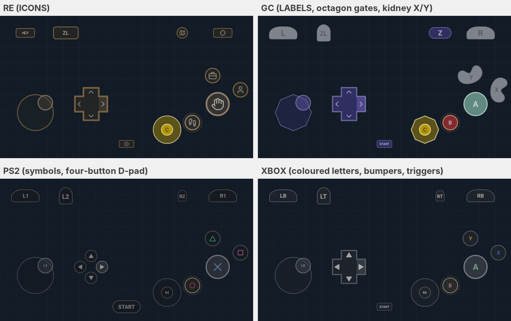

# RetroTouch 1.0.0-beta.13 — release notes

Skins, new shapes, two-colour and filled icons, a four-button D-pad, octagonal stick gates and
optical centering. **Drop-in update:** a game without skins draws pixel-identically to beta.12,
every beta.12 class and method remains, and saved layouts keep format 2.



## Quick start

```java
RetroTouchColors black = new RetroTouchColors(Color.rgb(25, 25, 28), Color.rgb(60, 60, 66),
        Color.rgb(110, 110, 118), Color.rgb(200, 200, 205)).withBorderWidth(0.05f);
RetroTouchColors grey = new RetroTouchColors(Color.rgb(205, 205, 210), Color.rgb(235, 235, 240),
        Color.rgb(120, 120, 130), Color.rgb(60, 60, 70));

RetroTouchSkin re = new RetroTouchSkin("re", "RE", RetroTouchButtonStyle.ICONS);

RetroTouchSkin gc = new RetroTouchSkin("gc", "GC", RetroTouchButtonStyle.LABELS)
        .setStickGate(RetroTouchStickGate.OCTAGON)
        .setLook("a", new RetroTouchLook().withLabel("A").withColors(RetroTouchColors.of(Color.rgb(30, 170, 120))))
        .setLook("x", new RetroTouchLook().withLabel("X").withColors(grey)
                .withShape(RetroTouchButtonShape.KIDNEY).withRotation(100))
        .setLook("l", new RetroTouchLook().withLabel("L").withColors(grey)
                .withShape(RetroTouchButtonShape.BUMPER));

RetroTouchSkin ps2 = new RetroTouchSkin("ps2", "PS2", RetroTouchButtonStyle.ICONS)
        .setDefaultColors(black)
        .setDpadStyle(RetroTouchDpadStyle.FOUR_BUTTONS)
        .setDpadIcons(RetroTouchIcon.ARROW_UP, RetroTouchIcon.ARROW_DOWN,
                RetroTouchIcon.ARROW_LEFT, RetroTouchIcon.ARROW_RIGHT)
        .setMoveStickLook(new RetroTouchLook().withLabel("L3"))
        .setLook("a", new RetroTouchLook().withIcon(RetroTouchIcon.SYMBOL_CROSS)
                .withColors(black.withIconColor(Color.rgb(110, 150, 230))))
        .setLook("zl", new RetroTouchLook().withLabel("L2").withShape(RetroTouchButtonShape.TRIGGER));

RetroTouchSkin xbox = new RetroTouchSkin("xbox", "XBOX", RetroTouchButtonStyle.LABELS)
        .setMoveStickLook(new RetroTouchLook().withLabel("LS"))
        .setLook("l", new RetroTouchLook().withLabel("LB").withShape(RetroTouchButtonShape.BUMPER))
        .setLook("zl", new RetroTouchLook().withLabel("LT").withShape(RetroTouchButtonShape.TRIGGER));

retroTouch.registerSkin(re);   // the editor's style button cycles in this order
retroTouch.registerSkin(gc);
retroTouch.registerSkin(ps2);
retroTouch.registerSkin(xbox);
retroTouch.setDefaultSkin("re");
retroTouch.setSkinListener(new RetroTouchSkinListener() {
    @Override public void onSkinChanged(String skinId) {
        // the player switched in the editor: update the game's own menu setting
    }
});
```

## New API, by request

### 1. Any number of styles: skins

| API | Purpose |
|---|---|
| `new RetroTouchSkin(id, name, baseStyle)` | A named look. `id` is saved as the choice, `name` is shown on the editor's style button, `baseStyle` (`LABELS` / `ICONS`) decides what a button without a look shows |
| `RetroTouchView.registerSkin(skin)` | Adds a skin (the view keeps a copy). The same ID again replaces it in place. Order = cycling order |
| `clearSkins()`, `getSkins()` | Remove all skins; list their IDs |
| `setDefaultSkin(id)`, `getDefaultSkin()` | Used while the player has not chosen; otherwise the first registered skin |
| `setSkin(id)`, `getSkin()` | Set (and save per game) or read the active skin; `getSkin()` is null without skins |
| `setSkinListener(RetroTouchSkinListener)` | `onSkinChanged(skinId)` when the player switches in the editor; the main listener may implement it instead |

- With two or more skins, the editor's style button cycles through them and shows the skin's name.
  With one skin there is no button.
- The choice is saved per game under its own key, separate from layouts; `RESET` keeps it.
- While skins are registered, `getButtonStyle()` returns the active skin's base style, and the
  LABELS / ICONS toggle is replaced.

### 2. Custom shapes per style

- `RetroTouchButtonShape.KIDNEY`: a bean for GameCube X / Y; default aspect 1.6.
- `BUMPER`: for L/R, L1/R1, LB/RB; default aspect 2.2.
- `TRIGGER`: for L2/R2, LT/RT, ZL/ZR; default aspect 0.8.
- For all three, the size is the height. They also work without skins (`setButtonShape`).
- `RetroTouchLook.withShape(...)`, `withAspect(...)` and `withRotation(degrees)` set them per action
  in a skin. A turned shape is touched on its turned outline; the label stays upright.
- `RetroTouchSkin.setStickGate(RetroTouchStickGate.OCTAGON)`: an octagonal gate around every stick.
  The knob follows the octagon; the reported values are unchanged.

### 3. Two-colour and filled symbols

- `RetroTouchColors.withIconColor(color)` and `withIconColors(normal, pressed, latched)`: the icon
  color, separate from the label and ring colors (blue cross on a black button).
- Getters: `getIconColor()`, `getPressedIconColor()` and `getLatchedIconColor()`. Without icon
  colors they return the text colors, so existing games look the same.
- `RetroTouchIcon.asFilled()` / `isFilled()`: filled glyphs.
- New built-in icons: `SYMBOL_CROSS`, `SYMBOL_CIRCLE`, `SYMBOL_SQUARE`, `SYMBOL_TRIANGLE`, and the
  filled `ARROW_UP`, `ARROW_DOWN`, `ARROW_LEFT`, `ARROW_RIGHT`.
- `RetroTouchSkin.setDpadIcons(up, down, left, right)`: for example the filled arrows on the D-pad.

### 4. Label or icon on the stick knob

- `RetroTouchSkin.setMoveStickLook(new RetroTouchLook().withLabel("LS"))` puts a label on the move
  stick's knob, or an icon with `withIcon`.
- `setLook(stickActionId, look)` does the same for a stick action, for example "R3" on the C stick.

### 5. Four-button D-pad

- `RetroTouchSkin.setDpadStyle(RetroTouchDpadStyle.FOUR_BUTTONS)`: four separate round buttons.
- `setDpadColors(...)` and `setDpadIcons(...)` set their colors and icons.
- Input is the same as with the cross (`nav_up`, `nav_down`, `nav_left`, `nav_right`).

### 6. Exact centering

- In skins and for the new shapes, labels and icons are centered on their ink, horizontally and
  vertically, independent of font ascent and descent. This applies to `L2`, `RT`, `START`, `SELECT`
  and to ✕ ○ □ △. On a KIDNEY or TRIGGER the content sits on the shape's visual center.
- `RetroTouchLook.withOffset(dx, dy)` moves the content per action by fractions of the button's
  height (-0.5 to 0.5).

## Look resolution in a skin

| What | Order |
|---|---|
| Content | look icon → look label → action icon (ICONS-based skin) → action label |
| Colors | look → control → action → skin D-pad colors (D-pads) → skin default colors → view default colors → built-in grey |
| Shape | look shape → control / `setButtonShape` / label (as without skins) |
| Aspect ratio | look → control in the default layout → `setButtonAspect` → shape default |

## Notes

- Skins draw like the ICONS style: the border inside the shape, a ring around latched buttons. In
  a LABELS-based skin the border is 2.5 dp unless `withBorderWidth` sets one.
- Skins, looks, shapes and colors are never stored in saved layouts. They come from the game on
  every load.
- Built-in symbol and arrow icons are RetroTouch's own drawings (MIT).

Tested: 128 automated tests against the AAR. 23 comparison images are pixel-identical to beta.12.
The library is checked against API 16 and API 36.
